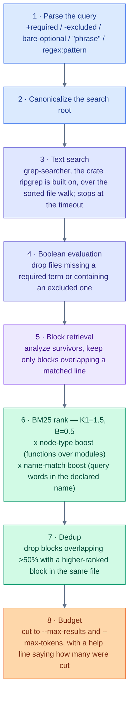

# Architecture

How `monokl search` is built today, then what is planned. Parts marked "planned" are not in the code. For the full designs, see [`docs/spec/`](docs/spec/README.md); for one subsystem, see [`docs/architecture/`](docs/architecture/README.md).

## Analyze once

Every file is parsed once, by a `LanguageAnalyzer`:

```
file text → LanguageAnalyzer::analyze() → FileAnalysis (owned: code blocks, test blocks, parse-error flag, degradation)
```

`FileAnalysis` never borrows from the parser's arena. Everything in it is owned data, so it can be shared across threads via `Arc` and outlive the parse call. This is a hard rule, not a style preference. An `AnalyzerRegistry` gives each file to the first analyzer that claims it. TypeScript and JavaScript use OXC, Rust uses `ra_ap_syntax`.

## The search pipeline

`monokl search` runs these stages. Each does less work on fewer candidates than the one before.



Stages 1 to 7 are core and cap nothing. Stage 8 and the output format live in the agent layer ([ADR 0003](docs/adr/0003-single-crate-with-core-and-agent-modules.md)), which prints through [michi](https://github.com/orin-dx/michi). Search holds no state between runs ([ADR 0004](docs/adr/0004-search-stays-stateless-and-every-stage-has-a-stated-bound.md)). Each stage has a stated bound: file size, line length, nesting, file count and time. See [Limits](README.md#limits).

## Planned

Nothing below is built. Each is a design in `docs/spec/`.

- **Cache.** An in-memory and disk cache of per-file analyses, keyed by content hash. Search is stateless today, and the design is in [cache-architecture.md](docs/architecture/cache-architecture.md).
- **Workspace index.** A `WorkspaceEnricher` layer would fold per-file analyses into an import graph and a symbol index without re-parsing. It needs the dependency and symbol output that was deleted because no command read it.
- **More commands.** `symbols`, `refs`, `definition` and `dependents`, which the index would serve.
- **Library session API.** A `Workspace` opened once, with snapshots and provenance, for embedders. See [`08-library-session-api.md`](docs/spec/08-library-session-api.md).
- **Per-operation precision.** A `CapabilityPrecision` level per analyzer operation, once a command needs to gate on it.
- **More languages.** Python, Go and Java. The registry takes a new analyzer without changing the pipeline.
- **Daemon and session mode.** See [daemon-lifetimes.md](docs/architecture/daemon-lifetimes.md).

## What's explicitly out of scope

Full list and rationale in [PRINCIPLES.md](PRINCIPLES.md#non-goals). Briefly:

- No persistent search index.
- No embedding-based retrieval by default.
- No stemming.
- No in-memory trigram index.
- No tree-sitter for TypeScript or JavaScript.
- No full [Salsa](https://github.com/salsa-rs/salsa) incremental framework. An open investigation, not ruled out.
